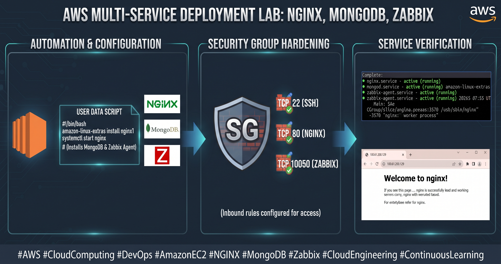

# ☁️ AWS Multi-Service Cloud Deployment & Automation Lab

<div align="center">



</div>

<p align="center">
  
  
  
  
</p>

---

## 📖 Executive Summary
This repository showcases an automated cloud infrastructure deployment on **Amazon Web Services (AWS)**. The project focuses on scalable infrastructure provisioning, automated configurations using **EC2 User Data scripts**, security group hardening, and multi-service management on **Amazon Linux 2**.

📥 **[Download Lab Documentation File (DOCX)](LAB3(ec2_multi_service_lab).docx)**

---

## 🏗️ Architecture & Component Stack
The EC2 instance acts as a centralized server bootstrapping three essential enterprise services upon initialization:

| Component | Port | Service Role & Function |
| :--- | :---: | :--- |
| **NGINX** | `80` | High-performance web server and reverse proxy, verified via public browser access. |
| **MongoDB** | Default | Scalable NoSQL database server backend (`mongod`)[cite: 1]. |
| **Zabbix Agent** | `10050` | Lightweight monitoring agent configured for infrastructure health tracking[cite: 1]. |

---

## ⚙️ Implementation Workflow

### 1. Provisioning & Configuration Automation
* Deployed an Amazon EC2 instance running Amazon Linux 2[cite: 1].
* Configured an automated **User Data boot script** to silent-install and launch NGINX, MongoDB, and Zabbix Agent on startup[cite: 1].

### 2. Infrastructure Security Hardening
Configured granular inbound rules on the AWS Security Group to regulate incoming traffic:
* **TCP Port 22 (SSH):** Restricted remote management access[cite: 1].
* **TCP Port 80 (HTTP):** Opened public web traffic access for NGINX[cite: 1].
* **TCP Port 10050 (Zabbix Agent):** Configured network tracking for systems monitoring[cite: 1].

### 3. Validation & Verification
* Established a secure SSH session to inspect systemctl service statuses (`active (running)`)[cite: 1].
* Verified live web server accessibility via the instance's public IP address[cite: 1].

---

## 📂 Repository Structure
```text
├── LAB3(ec2_multi_service_lab).docx   # Comprehensive lab manual and documentation
├── aws-ec2-multi-service-lab.png      # High-level architecture and execution workflow
└── README.md                          # Project documentation
